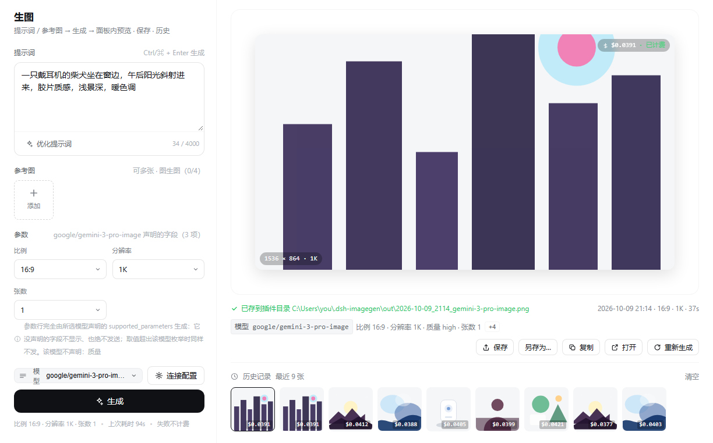
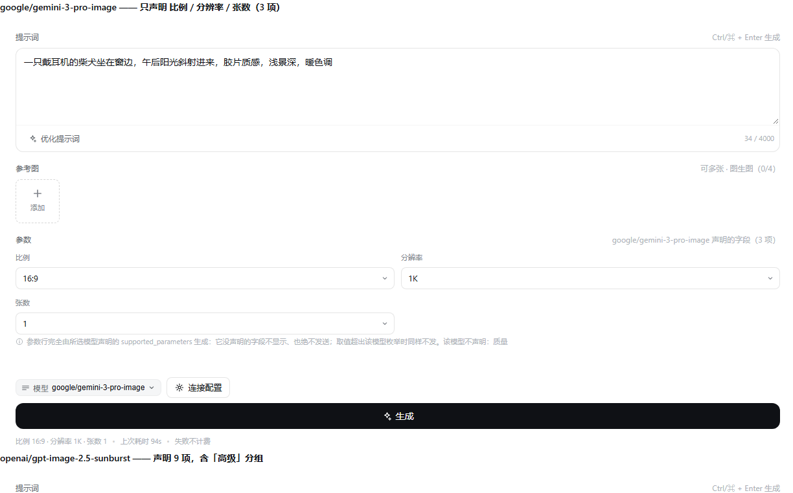
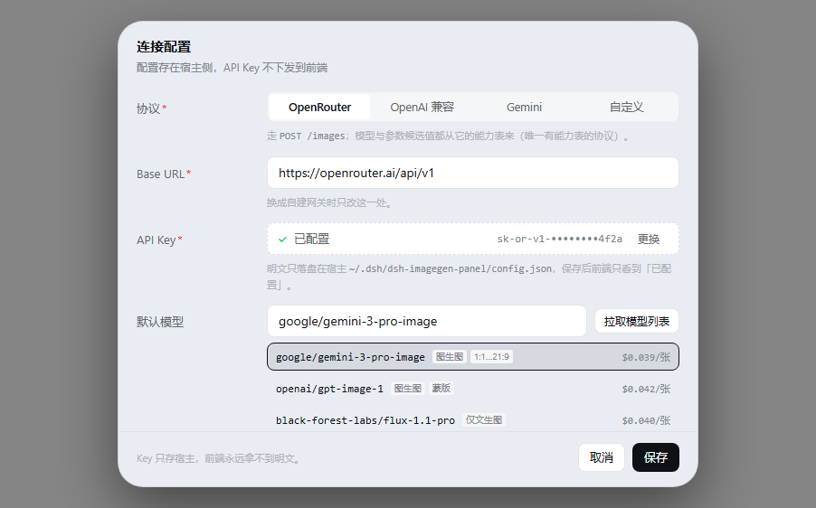

# dsh-imagegen-panel

DSH 桌面版（DSH desktop）的**生图插件**：左侧栏「插件」**上方**加一行「生图」，
点开主区就是一个完整的生图工作台 —— 提示词 / 参考图 → 生成 → 面板内预览 · 保存 · 历史。

- **宿主半边**：`/dsh-imagegen/*` 十二条 loopback 路由、配置存储、上游协议适配、图片落盘
- **浏览器半边**：输入区 / 参数区 / 结果舞台 / 历史条 / 连接配置弹层 / 日志抽屉
- **API Key 明文永不下发到浏览器**：前端拿到的只有 `hasKey: boolean` 与掩码 `keyHint`



---

## 功能

| 能力 | 说明 |
|---|---|
| 侧栏入口 | 左侧栏「插件」上方一行「生图」（`order: -1`），点开主区即面板 |
| 文生图 | 提示词 → 生成；`n` 张一次出（模型声明了才给选） |
| 图生图 | 拖入 / 选择参考图，上限按所选模型 `input_references.max` 动态跟随（宿主再按 16 兜底） |
| 参数随模型 | 参数区**完全由所选模型声明的 `supported_parameters` 生成**：未声明的字段不显示、也绝不发；支持下拉 / 张数 / 数字 / 文本 / 开关五种控件 |
| 模型候选值 | 拉 OpenRouter 权威能力表（含定价）驱动候选值与默认值，超范围的值级参数在宿主侧裁剪并如实回报 `dropped` |
| 价格与用量 | 结果行显示上游返回的 `usage.cost`，历史缩略图带单张成本 |
| 历史记录 | 落盘索引 + 缩略图条；**右键**一张历史图 →「打开 / 作为参考图 / 保存到工作区 / 复制图片」 |
| 结果事实行 | 每张图记录当时的模型与参数（面板值 `params` 与实发值 `sentFields` 分开存），点历史图回填提示词与参数 |
| 草稿跨重启 | 面板状态（提示词 / 参数）落盘 `draft.json`，「上次生成成功 → 空面板、写了没生成 → 留着」 |
| 保存 | 生成后自动另存到配置的目录，另有「保存 / 另存为… / 复制 / 打开 / 重新生成」 |
| 用系统默认程序打开 | 「打开」把本地原图交给桌面 shell（`explorer.exe` 的文件关联语义），不自己解析关联表 |
| 提示词优化 | 复用已装的 `dsh-prompt-forge` 的「文生图优化」模板，SSE 流式替换 + 一键撤销 |
| 日志看得见 | 宿主日志进面板抽屉（刷新 / 复制 / 下载 / 落盘路径）；`/generate` 失败响应带 `diagnostics[]` |
| 四协议 | OpenRouter / OpenAI 兼容 / Gemini / 自定义，见下表 |

参数区只显示该模型真正声明的东西 —— 切到 `google/gemini-3-pro-image` 就只有比例 / 分辨率 / 张数：



## 不做什么

刻意不含：给模型注册工具（本插件只有 UI，没有 `generate_image` 之类）、独立设置页（配置全在主界面的连接弹层）、OpenAI 图生图（`/images/edits` multipart）、Gemini 的参数映射、多轮对话式改图。

---

## 安装

### 用户安装（从 GitHub）

仓库自带构建产物（`lib/` 已提交），所以 GitHub 源码安装开箱可用：

```sh
dsh plugin --profile desktop add github:zhaoxiagongsi001/dsh-imagegen-panel
```

装完**刷新一次页面**（客户端 bundle 首次加载必须刷新），左侧栏「插件」上方即出现「生图」。

首次打开是「未配置」屏，点右上「连接配置」填 Base URL + API Key（默认走 OpenRouter），保存后即可生成。

### 开发期安装

```powershell
# 1. 装依赖（构建与自检需要 typescript / react）
npm install

# 2. 构建两个半边 → lib/index.js（宿主）+ lib/client.js（浏览器）
npm run build

# 3. 离线自检
npm run check        # host-check + render-check
npm run upstream     # 真上游公开接口 → 本插件解析器（不需要 Key）
npm run live         # 对**运行中的 DSH** 打真路由（可选）

# 4. link 进 profile：link 指向源目录，重建即生效
dsh plugin --profile desktop add "link:<本仓库路径>"
```

> `host-check` 用 `DSH_IMAGEGEN_HOME` 把存储指向临时目录，**不碰**你的真实配置。
> `live-check` 会真写一次配置（一把一次性测试 Key），跑完清掉并还原字段；
> 若检测到**已经有 Key**，它会跳过写 Key 的那段，绝不清你的真 Key。

---

## 支持的协议

| 协议 | 出图端点 | 鉴权 | 备注 |
|---|---|---|---|
| `openrouter` | `POST {base}/images` | `Bearer` | 唯一有能力表；参数候选值由 `supported_parameters` 驱动 |
| `openai` | `POST {base}/images/generations` | `Bearer` | 比例映射成 `size`；**图生图（`/images/edits`）未接** |
| `gemini` | `POST {base}/models/{id}:generateContent` | `x-goog-api-key` | **不吃**比例/分辨率/质量（会如实裁掉并回报） |
| `custom` | `POST {base}/images` | `Bearer` | 原样透传 + 额外参数；模型 id 手填 |

配置与数据存放：`~/.dsh/dsh-imagegen-panel/`
（`config.json` + `index.json` + `draft.json` + `out/` + `logs/`）

```json
{ "version": 1, "updatedAt": "…", "apiKey": "sk-or-v1-…",
  "protocol": "openrouter", "baseUrl": "https://openrouter.ai/api/v1",
  "model": "…", "autoSaveDir": "…", "extraJson": "…", "timeoutSec": 180, "outputFormat": "png" }
```

> **为什么不是 `~/.dsh/dsh-imagegen/`**：那个目录是 DSH 内置 `dsh-image-gen` 插件的数据目录。
> 两个插件共用一个目录，迟早会因为一个同名 `config.json` 互相踩。

---

## 宿主路由一览

宿主半边挂 12 条路由（覆盖下表的 15 个路径 + 方法组合，**全部 loopback-only**，见 `src/http.ts` 的围栏）：

| 路径 | 方法 | 作用 |
|---|---|---|
| `/dsh-imagegen/config` | GET | 回配置：**只有 `hasKey` + 掩码 `keyHint`** |
| `/dsh-imagegen/config` | PUT | 收配置（明文 Key 只在这一跳里）→ 校验 → 原子落盘 → 只回掩码 |
| `/dsh-imagegen/models` | GET | 代理上游模型目录（OpenRouter 走公开接口；其他协议回空表 + 说明） |
| `/dsh-imagegen/capabilities` | GET | 代理 `{base}/images/models/<id>/endpoints`：权威能力 + 定价 |
| `/dsh-imagegen/generate` | POST | 真出图：按协议适配层发请求，Key 不进浏览器 |
| `/dsh-imagegen/history` | GET | 读 `index.json`（最新在前） |
| `/dsh-imagegen/save` | POST | 手动保存一份到指定目录（默认「自动保存目录」） |
| `/dsh-imagegen/open` | POST | 用**系统默认程序**打开某张图的本地原图 |
| `/dsh-imagegen/preset` | GET | 读 prompt-forge 的「文生图优化」模板文本（跨插件） |
| `/dsh-imagegen/image/<id>` | GET | **prefix** 路由：把落盘的图喂给浏览器 |
| `/dsh-imagegen/health` | GET | 自查：路由、配置路径、有没有 Key、存了几张 |
| `/dsh-imagegen/logs` | GET | 宿主日志（面板「查看日志」读它）；`?format=text` 直接下载 |
| `/dsh-imagegen/logs` | DELETE | 只清内存缓冲（磁盘上的日志文件保留） |
| `/dsh-imagegen/draft` | GET | 面板草稿；没有草稿文件时回 `draft: null` |
| `/dsh-imagegen/draft` | PUT | 收草稿 → 宽松收敛 → 原子落盘（**写失败不影响打字**） |

配置弹层里 API Key 已配置时只显示掩码，明文只在 `PUT /dsh-imagegen/config` 的请求体里出现一次：



---

## 出图链路

```
面板点「生成」
  → POST /dsh-imagegen/generate
      → 读磁盘配置拿 Key / base / 超时 / 额外参数
      → 拉模型能力表（带 10 分钟缓存）→ buildImageRequest 裁剪字段（key 缺失 = 不发）
      → POST {base}/images   Authorization: Bearer <Key>
      → data[].b64_json → 写 out/ + 更新 index.json（尺寸从文件头量）
  → 返回 { image: { id, imageUrl, size, cost, … }, count, dropped }
  → 面板 ">
```

**取消**：面板 abort → 宿主 `req.on('close')` → 上游请求一起 abort（回 499）。
**超时**：配置里的 `timeoutSec`（5–3600 秒），到点回 504。
**错误**：上游原文（402 / 429 / 模型不存在…）原样进 `message`，面板直接展示，不美化转述。

### 图生图（参考图）

```
Composer 上传底图 → FileReader 读成 data URL → request.references[]
  → 宿主 buildImageRequest() → input_references[{ type:'image_url', image_url:{ url } }]
  → POST {base}/images
```

参考图上限一律 `min(模型声明, 16)`，另回 `referencesDeclaredMax` 让界面解释差额；
客户端先做下采样（长边 ≤2048、单张 ≤4 MB），装不下就明确拒绝而不是静默丢弃。

**历史图直接当参考图**：在底部历史条上**右键**任意一张 →「作为参考图」。
链路是「历史缩略图 →（宿主 `/image/<id>`）→ Blob → data URL → 参考图槽」——
绕这一圈是必要的：参考图是**随请求体一起发**的，不能只给宿主一个 URL 让它自己去取。

### 提示词优化（跨插件：复用 prompt-forge）

「优化提示词」按钮**不自己写 LLM 逻辑**，而是复用已装的 `dsh-prompt-forge`：

```
点「优化提示词」
  → GET /dsh-imagegen/preset                     ← 我们宿主：读它的「文生图优化」模板文本
      取值链：settings.describe() → configEditor.configuration() → profile 的 cordis.patch.yml
      ?debug=1 回各来源的结构速写（只回键名/类型/长度，正文与密钥脱敏）
  → POST /api/dsh-prompt-forge/optimize（同源）   ← 它自己的 SSE 路由
      body: { text, system: 模板 + 一句输出约束 }
      → start → delta×N → done，边收边写进输入框
  → 结果直接覆盖输入框，旁边出现「撤销」
```

四个设计决定：

1. **按语义找模板，不按字段名**：深度搜索「谁给出了一份带 `presets`、且其中有个模板叫
   『文生图优化』的配置」。第一版按 `entry.name === 'dsh-prompt-forge'` 硬匹配，真机直接
   回「没找到」—— Entry / SettingsDescriptor 不是我们的类型，字段名随时可能变。
2. **第 2 步在浏览器侧打**，不经我们宿主 —— 宿主不知道自己的监听端口，绕一圈要引入端口发现；
   浏览器本来就在那个 origin 上，还能顺手把增量渲染出来。
3. **模板末尾补一句输出约束**：prompt-forge 用户那个「文生图优化」模板是推理型的，
   没有 prompt-forge 内置模板都有的 OUTPUT_ONLY 那句。实测不加会回「优化思路 + 最终提示词」两段，
   加了才是一段干净的提示词。**不改对方的模板**。
4. **模板名写死「文生图优化」**；名字对不上时允许包含匹配，再找不到就 404 并列出可用模板名。

未装 prompt-forge 时该按钮仍然可用吗？—— 不可用：`/preset` 回 404，按钮提示需要先装它。

---

## 接线原理

侧栏的 `sidebar.panellist` 与主区的 `main` 用**同一个字符串**做 key：

```ts
const PANEL_ID = 'imagegen'                                  // 与 cordis.patch.yml 的行 id 一致
slots.register({ name: 'sidebar.panellist', id: PANEL_ID, order: -1, label: () => '生图' }, Icon)
slots.register({ name: 'main', key: PANEL_ID }, Panel)
```

`main` 的 catalog 原文是「Central panel **selected by sidebar entry id**」，
registration `key` 是「the entry renders where the owner dispatches this exact key」。
所以**不需要任何导航代码**，壳自己把 id 和 key 对上。

侧栏那一行的**外观由壳负责**（行高、悬停、选中态、收起态、文字省略），
本插件只提供图标组件与 `label` —— 这也是为什么这里一行侧栏 CSS 都没有。

**`order: -1`** 是「排在『插件』(order 0) 之上」的唯一依据。

---

## 目录

```
src/
  index.ts                 宿主半边：挂 /dsh-imagegen/* 十二条路由
  log-store.ts             宿主日志：环形缓冲 + 按天落盘 + 密钥脱敏（面板「查看日志」的后端）
  config-store.ts          宿主侧配置：读/写/校验/掩码（原子写 + 损坏备份）
  draft-store.ts           面板草稿：prompt / params / extra / lastGeneratedPrompt
  openrouter.ts            OpenRouter 适配层：模型目录 / 能力定价 / 请求体构造 / 响应解析
  providers.ts             四协议适配（OpenRouter / OpenAI 兼容 / Gemini / 自定义）
  image-store.ts           出图落盘：out/ + index.json，尺寸从 PNG/JPEG/WebP 文件头量
  open-file.ts             交给桌面 shell 打开本地原图（explorer 的文件关联语义）
  forge.ts                 读 prompt-forge 的「文生图优化」模板（跨插件取值链）
  http.ts                  writeJson / readJsonBody / loopback 围栏
  client/
    index.tsx              槽位接线（两个 register）+ 供自检用的导出
    ImageGenPanel.tsx      根组件：状态机、生成流程、草稿规则、点历史图回填、配置弹层挂载
    Composer.tsx           左栏：提示词 / 参考图 / 参数 / 生成
    ResultStage.tsx        右栏：舞台（空/生成中/已出图/出错）+ 操作条 + 历史条
    labels.ts              结果行的字段中文标签（与宿主 FIELD_SPECS 对齐，自检有断言）
    LogViewer.tsx          宿主日志抽屉
    ConfigModal.tsx        连接配置弹层
    api.ts                 真后端：打宿主路由
    defaults.ts            客户端首帧兜底配置（宿主才是权威）
    art.tsx                占位插画（没有 imageUrl 时用）
    icons.tsx              图标集
    types.ts               Backend 接口与全部共享类型
    panel.module.css       面板样式
scripts/
  build.mjs                手写 bundler（TS API，无子进程）
  host-check.mjs           假 ctx + 假上游 → 真路由 → 真落盘（临时目录）
  render-check.mjs         真实 React 离屏渲染各状态 + 槽位注册契约断言
  upstream-check.mjs       真上游公开接口 → 本插件解析器（模型目录 / 能力 / 定价 / 裁剪）
  live-check.mjs           真机验收（打运行中的 DSH，自带清理与配置/草稿还原）
  preview.mjs              生成离屏预览页（15 个状态）
  param-matrix.mjs         生成逐模型参数矩阵（数据源，见 PARAM-MATRIX.md）
```

---

## 自检

插件只在 DSH 的 Web GUI 里出现，而那只 GUI 随时在用 —— 拿它当测试台既慢又打扰。
所以前三关都能自动跑，最后一道只做「装上去之后确实是这样」的确认：

- **`host-check.mjs`** —— 用打包后的 `lib/index.js` 配一个假 ctx
  （`inject` / `effect` / `webServer.register`）+ **一个假上游**
  （`globalThis.fetch` 换成按 URL 分发的桩），跑**真路由处理器**：配置读写、Key 掩码、
  落盘往返、模拟重启、非法输入、loopback 围栏、模型/能力/定价映射、请求体裁剪、
  b64→磁盘、尺寸测量、`n>1`、上游 402/500/空数据、取消、超时、无 Key。
  存储根由 `DSH_IMAGEGEN_HOME` 指向临时目录，跑完即删。
  **真出图要花钱，但「请求对不对、图落没落盘、错怎么报」在这里全验完了。**
- **`render-check.mjs`** —— 用与生产完全相同的产物（`lib/client.js`）+ 真实 React
  离屏渲染，覆盖空态/生成中/已出图/出错/弹层/真图，并断言 `apply()` 注册进去的槽位参数。
- **`upstream-check.mjs`** —— 拿**真上游**（公开接口，不需要 Key）的响应喂给
  本插件的解析器：模型目录、能力合并、定价、请求体裁剪。上游改字段时第一时间报警。
- **`live-check.mjs`** —— 对**运行中的 DSH** 打真 HTTP：路由在不在、下发面有没有
  多出内部字段、PUT 的响应里搜不到明文 Key、磁盘上确实落了明文、清 Key 能清干净。
  它自带走火开关：检测到已有 Key 就跳过写 Key，绝不误清。
- **`preview.mjs`** —— 把同一批组件渲染成单文件 HTML，配色/圆角/字体走同一批
  DSH design token，改完刷新即可。

---

## 几条硬约束

1. **API Key 明文永不下发到浏览器。** 宿主路由只回 `hasKey: boolean` + 掩码 `keyHint`；
   弹层里「已配置」是唯一展示形态。明文只在 `PUT /dsh-imagegen/config` 的请求体里出现一次。
   `host-check.mjs` 有两条**负面断言**：PUT/GET 的响应体里搜不到明文。
2. **宿主路由必须自带 loopback 围栏。** 已核对 DSH 源码：浏览器鉴权（进程 token / 签名
   cookie）**只保护 `/api` 前缀与首页 index**，插件自己挂的路由不在其内 —— 所以
   `isLoopbackRequest()`（环回地址 + 环回 Host + 同源 Origin）不是可选项。
3. **参数候选值由模型能力驱动，不许硬编码。** 从
   `GET /images/models/<id>/endpoints` 的 `supported_parameters` 生成（key 缺失 = 不支持）。
   `buildImageRequest` 会把模型没声明的字段**一个都不发**，并在响应 `dropped` 里如实回报。
4. **不给模型注册工具** —— 本插件只有 UI。
5. **插件不依赖宿主的全局样式。** CSS 按模块作用域，`box-sizing` 自带 ——
   宿主**没有** `*{box-sizing:border-box}` reset（已核对），依赖它会让输入框溢出。
6. **`apply()` 必须能退化。** 从 `apply` 抛错会让 cordis fiber 进 FAILED，
   连带整个 web 启动一起挂掉。槽位注册与路由注册一律包 `try/catch`。
7. **宿主半边的相对 import 必须写成单行。** `scripts/build.mjs` 的宿主打包器逐行扫描
   `import … from '…'` 来找依赖图；多行 import 不会被内联，而构建**照样报成功**，
   只在运行时报模块找不到。客户端半边没这个限制（它走 `require`）。
8. **宿主半边所有模块共用一个作用域。** 两个模块各写一个同名顶层 `const` 会拼出
   `SyntaxError`（而构建照样"成功"）—— 已给打包器加了**构建期跨模块重名检查**。
9. **路由路径只写两处，且必须一致。** 宿主 `src/index.ts` 的 `API` 与客户端
   `src/client/api.ts` 的 `ROUTES`；`host-check.mjs` 会逐条字面比对。
10. **prefix 路由注册时不能带尾斜杠。** webServer 的匹配是
    `pathname === prefix || pathname.startsWith(prefix + '/')` —— 写成
    `/dsh-imagegen/image/` 就要求路径里出现 `//`，于是 `/image/<id>` 永远匹配不上、
    回 404（真机上表现为「面板里图全裂」）。`host-check` 有回归断言守着这条。
11. **改宿主半边要重启 DSH。** DSH 的 HMR 默认只热重载配置，源码模块热替换是 opt-in：

    | 改了什么 | 生效方式 |
    |---|---|
    | `src/client/*` | `npm run build` 后即生效（bundle 含 `client-hmr`），通常不用刷新页面 |
    | `src/index.ts`、`src/config-store.ts` 等宿主文件 | **重启 DSH 一次** |

    判定方法：`GET http://127.0.0.1:19387/dsh-imagegen/health` —— 返回 JSON 就是挂上了，
    404 就是还在跑旧模块。

---

## 文档

| 文件 | 内容 |
|---|---|
| `OPENROUTER-IMAGE-API.md` | OpenRouter 图像 API 的实测契约：端点 / 字段 / 参数描述符 / 定价结构 / 坑 |
| `PARAM-TABLE.md` | 逐模型参数配置表（人读版）+ 字段规格总表 + 图生图专章 |
| `PARAM-MATRIX.md` | 脚本生成的原始参数矩阵（逐模型 11 列），数据源 `stage-param-matrix/matrix.json` |

---

## License

[MIT](LICENSE) © 2026 zhaoxiagongsi001
